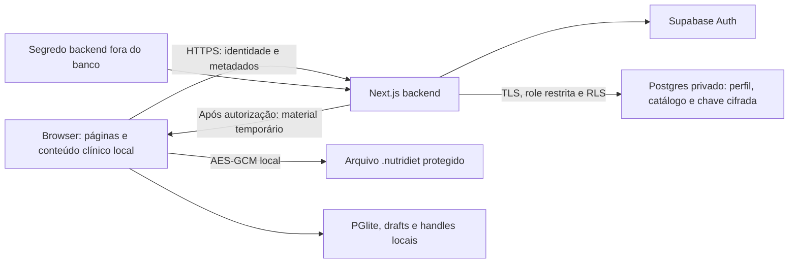

# Implementation Plan: Contas Supabase e saves locais protegidos

**Data**: 2026-10-10. **Branch atual preservada**: `codex/diet-pdf-export`.

**Especificação**: [spec.md](./spec.md). **Estado**: desenho proposto, aguardando validação humana. Nenhum item abaixo foi implementado nesta entrega.

## Summary

Landing placeholder, login, cadastro, recuperação e dashboard de saves no Next.js existente. Supabase guarda identidade, perfil cifrado, catálogo e chaves cifradas; o backend autoriza operações remotas. Arquivos, banco clínico e drafts continuam locais. Cada save recebe chave permanente utilizável em memória apenas pelo proprietário após validação online. Um save já aberto permite continuidade local por até oito horas.

Cadastro: faixas autodeclaradas **1–6 meses**, **6–12 meses** ou quantidade de anos; média mensal de pacientes. E-mail confirmado antes do acesso privado.

## Technical Context

| Item | Decisão |
| --- | --- |
| Linguagem/framework | TypeScript 5, React 19, Next.js App Router existente; lock atual Next 15.5.22. Sem upgrade de framework. Runtime Node nas rotas backend. |
| Dependências existentes | Drizzle 0.45.2, PGlite 0.5.8, Radix/Shadcn e design system do repositório. |
| Novas dependências necessárias | `@supabase/supabase-js`, `@supabase/ssr`, `postgres` e marcador `server-only`; verificar compatibilidade e fixar versões no lock durante setup. Nenhum SDK Supabase no bundle cliente. |
| Armazenamento | Supabase Auth/Postgres privado: identidade/metadados. File System Access, PGlite e IndexedDB: arquivo/workspace/drafts/referências locais. |
| Testes | Vitest, Testing Library e Playwright existentes; Supabase local descartável para integração Auth/roles/RLS. Testes novos sob `tests/`. |
| Plataforma | Desktop >=1024px, claro. Chrome/Edge com File System Access; ausência da API produz indisponibilidade explícita. |
| Desempenho | Catálogo paginado de 50 registros, contagem e navegação até todos os saves. Verificar arquivos só na página visível; não carregar conteúdo clínico remoto. Nenhum SLA/throughput pedido. |
| Restrições | Sem trânsito clínico, segredo persistido no cliente, abertura offline ou publicação. Preservar legado/drafts. |
| Escala | Vários saves por conta, um dono por save; sem equipes, compartilhamento ou sincronização clínica. |

Versões exatas dos novos pacotes serão resultado do setup futuro. Organização/projeto Supabase e SMTP são entradas operacionais tratadas antes de provisionar, não perguntas funcionais abertas. Nenhum alvo remoto foi escolhido.

## Constitution Check

| Gate | Antes da pesquisa | Após desenho |
| --- | --- | --- |
| Atomic Design | PASS: reutilizar camadas existentes | PASS: páginas/adapters compõem organismos, servidor em lib/server |
| DS canônico, categorias antes de perfis | PASS: documentos e categorias consultados | PASS: Input/SelectField/Button/Surface/Badge/DataTable e registry coordenado |
| Desktop, teclado, WCAG 2.2 AA | PASS: NFR-001 explícito | PASS: testes de foco, erro, teclado, zoom e estados |
| Contratos/falhas antes da implementação | PASS: nenhum código alterado | PASS: tarefas de teste antes de cada implementação substancial |
| `/speckit-implement`, evidência de estado | PASS: somente SDD | PASS: tarefas abertas, sem alegação de conformidade do código |

Sem exceção constitucional. Documentos históricos que excluíam login/cifra serão atualizados conforme o novo pedido, preservando soberania clínica e retrocompatibilidade.

## Arquitetura e confiança



### Identidade e segurança de requisições

Route Handlers próprios validam campos, corpo, tamanho, origem/CSRF. Operações mutáveis e liberação de chave usam POST; respostas privadas usam `Cache-Control: no-store`. Sem CORS de terceiros ou redirect arbitrário.

Supabase Auth por requisição somente no servidor; cookies HttpOnly, SameSite=Lax, Path=/, Secure em HTTPS. Backend renova sessão; nunca retornar access/refresh token em JSON nem usar `createBrowserClient`. Guard privado exige `getUser()` válido, não anônimo, e-mail confirmado, perfil existente e `session_id` do JWT validado associado ao mesmo usuário em `auth.sessions`. Middleware/layout apenas orientam navegação; cada handler repete validação. `getSession`, `user_metadata`, owner enviado e estado da UI não autorizam.

POST exige Origin igual a `APP_ORIGIN` e token CSRF selado, ligado à sessão quando autenticado. Formulários anônimos recebem token público de formulário sem autoridade de identidade. Ausência/divergência de origem falha. GET dos links de e-mail só prepara confirmação/reset em cookie selado curto e redireciona para URL limpa; consumo ocorre no POST, com propósito fixado no servidor.

Bootstrap de perfil: INSERT-only, FK real a `auth.users`, `ON CONFLICT DO NOTHING`. Retorno de signup duplicado não prova posse e nunca altera perfil. Falha de perfil não libera catálogo/chave. Se o e-mail já foi confirmado e o perfil ficou ausente, login prova identidade/sessão e encaminha para modo Concluir cadastro da mesma `/criar-conta`: apenas nome/sobrenome/perguntas profissionais. Handler de conclusão valida identidade/e-mail/sessão sem exigir perfil prévio e faz INSERT-only do próprio owner; perfil existente não é sobrescrito. Retorno ofuscado de signup nunca serve para essa reparação. Perfil sem e-mail confirmado não autoriza save.

Rate limit durável em buckets privados HMAC com incremento atômico: login 10/10min por e-mail e 50/10min por IP; signup/recovery 3/h por e-mail e 10/h por IP. Sem e-mail/IP legíveis ou contador só em RAM. Indisponibilidade nega operação; limites do provedor permanecem habilitados. Logs somente tipo/código/requestId, sem corpos, query sensível ou tokens.

### Banco privado e conexão

Desabilitar Data API do projeto dedicado. Schema `private`, sem grants a PUBLIC/anon/authenticated nem funções privilegiadas expostas. Driver `postgres` + Drizzle, Supavisor transacional, TLS validado, `prepare:false`, pool pequeno. Runtime NOBYPASSRLS, sem ownership/herança administrativa; admin de migração é outra credencial.

Catálogo em transação única com `set_config('app.owner_id', UUID validado no backend, true)`; ausência de ator nega. Não conservar ator no pool. Claim é UNIQUE/atômico e conflito não expõe outro dono. Perfil e saves exigem somente INSERT/SELECT pela role runtime, sem UPDATE/DELETE. Runtime recebe só SELECT(id,user_id) em Auth sessions. Bootstrap usa o ator retornado pelo serviço Auth; conclusão de perfil usa sessão verificada. Buckets conservam os privilégios mínimos de incremento/limpeza com policy restrita à role runtime.

Segredos fora do banco/Git, sem `NEXT_PUBLIC_SUPABASE_*`. Não usar service_role como acesso de dados normal. RLS protege de consultas erradas, não de comprometimento completo do backend.

### Chave permanente e codec único

Backend gera DEK aleatória de 32 bytes por save uma única vez e cifra AES-256-GCM sob master KEK externa, nonce novo, AAD com propósito/owner/save/Conta clínica. Perfil próprio e nome do save também cifrados. E-mail somente no Auth; senha em bcrypt do provedor.

Prova pública opaca imutável: HMAC-SHA256 do tuple imutável e identidade da chave, com chave derivada por HKDF da KEK e propósito separado. Backend compara prova em tempo constante antes de liberar material. Prova não contém DEK, não autoriza sozinha e não é MFA. Conta + vínculo são verificados no backend; integridade do ciphertext clínico é verificada localmente por GCM.

Browser importa CryptoKey não extraível em memória e descarta buffer bruto assim que possível. Codec único cobre principal e backup do menu: IV aleatório 12 bytes novo em cada cifra, tag 128 bits, AAD determinística do cabeçalho. Envelope externo protegido versão 2; payload mantém BackupEnvelope versão 1/schema 11 e migradores. Não persistir DEK em storage, logs, URL, props SSR ou arquivo.

Login/reset/relink/export não mudam DEK. Rotação futura de wrapping conserva chave lógica e exige reter verificação de provas antigas; não implementar serviço de rotação nesta fase. Backup seguro de KEK é pré-requisito operacional.

### Sessão clínica, conservação e prazo

Autorizar online `(ownerId,saveId,localAccountId)` antes de hidratar workspace. PGlite isolado pelo tuple; não confiar no ID de JSON. Conservar revisões/drafts existentes mais novos que o arquivo, sem substituição silenciosa.

Grant contém authorizedAt e expiresAt=+8h. Deadline monotônico + verificação no retorno da suspensão e aquisição de operações. Refresh de cookie, localização, checkpoint e request falho não renovam grant. Login/criação/abertura/reload precisam de rede; janela vale só para página/save já abertos. Sem PWA/cache de todas as rotas: destino nunca carregado pode precisar de rede sem apagar workspace.

Estado locked distinto de paused (falha de escrita). Guard cobre getters/operações já capturados, além de navegação. Logout/prazo bloqueiam imediatamente novas operações e apresentação; conservam autosave pendente e finalizam só escritas aceitas antes do bloqueio. Flush antes de desmontar editor; falha conserva estado privado para recuperação. Retirar runtime acessível e chave da sessão após conservação; não apagar PGlite/drafts/arquivo.

Logout local funciona offline: bloqueia/remove material e fica revogação remota pendente para processar antes de nova autorização ao reconectar. Não prometer revogação remota imediata durante indisponibilidade. Reset encerra sessões via signOut global após trocar senha. Sessão offline já aberta continua no máximo até reconhecer revogação ou completar 8h. Não há revogação criptográfica contra dono do dispositivo.

### Dashboard, criação e legado

DataTable paginada: nome, arquivo lembrado localmente, Sincronizado/Desincronizado, Abrir/Localizar; Criar novo save primário e Importar existente secundário. Checking usa loading; permissão pendente mostra motivo. Disponibilidade e checkpoint são calculados no computador, sem copiar progresso de gravação para o banco remoto.

Novo: escolher destino → gerar Conta clínica → registrar vínculo idempotente → cifrar → write/close → reler/validar → ativar runtime. Retry conserva idempotencyKey e DEK; falha deixa vínculo recuperável sem falso sucesso. Guardar os identificadores não secretos da tentativa junto das referências locais para retomar após interrupção; não guardar material utilizável da DEK. Registro sem arquivo acessível aparece Desincronizado. Nenhum POST adicional relata gravação ao servidor.

Handles locais por owner/save, não path remoto. Verificar permissão/cabeçalho para localização; abertura ainda exige grant online. Mudança de dispositivo/origem/limpeza de storage exige selecionar novamente.

Legado: validar/migrar em memória → adoção explícita de identidade ainda livre → claim atômico → OUTRO destino comparado por identidade de handles → cópia cifrada validada → abrir. Não sobrescrever original/migrar base antes de validar vínculo. Retry do dono mantém DEK; outro dono recebe erro genérico. JSON editável não comprova dono histórico; cópias antigas/adulteradas não recebem proteção retroativa.

Novo e legado usam o mesmo registro remoto de owner/identidade clínica/chave. O parser local já distingue os formatos; o backend não recebe um campo de tipo de importação sem efeito sobre autorização.

## Project Structure e alcance

Documentação toda nesta pasta: spec/checklists/plan/research/data-model/contracts/quickstart/tasks/analysis-report/sdd-status.

Arquivos propostos de implementação (novos ainda não existem):

```text
src/app/{page.tsx,login/,criar-conta/,recuperar-senha/,redefinir-senha/,saves/}
src/app/auth/{confirm/,recovery/}
src/app/api/{auth/,saves/}
src/components/organisms/{LoginForm,RegistrationForm,RecoveryPasswordForm,
  ResetPasswordForm,SavesDashboard}.tsx
src/lib/server/{auth/,online-db/,save-keys.ts,request-security.ts}
src/lib/application/online-save-session.ts
src/lib/infrastructure/crypto/protected-save.ts
src/lib/domain/protected-save.ts
supabase/{config.toml,migrations/,templates/}
tests/{server/,application/,infrastructure/,components/,browser/,fixtures/}
```

| Código existente | Alcance obrigatório |
| --- | --- |
| `src/app/{layout.tsx,SessionAwareAppShell.tsx,home/page.tsx}` | Público sem gate clínico; saves exige conta; rotas clínicas exigem grant; manter URLs atuais, /home encaminha entrada. |
| `profile-session.ts` | Autorizar antes de carregar; cifrar writeSnapshot; conservar cancelamento/retry/revisões/checkpoint. |
| `backup-application.ts` + `SidebarNavigationAdapter.tsx` | Export/validate/restore com codec e autorização, inclusive chamadas diretas. |
| `browser-composition.ts` | Isolar tuple sem perder recuperação do workspace mais novo. |
| `file-system-access/browser-save-file.ts` | Handles múltiplos, comparação de destinos, abort em falha e sucesso após close. |
| Hooks do editor e navegação/perfil/onboarding | Flush de autosave, logout online, entrada pela dashboard; mapear todos os consumidores e helpers de browser. |
| Fixtures/testes/registry/exports/docs | Conservar migradores 4–11, fixture schema 10; expectativas de plaintext só para legado; categorias/perfis novos coordenados. |

App único, sem microserviço ou abstração DDD nova. Reusar componentes; primitivo só recebe extensão acessível indispensável, sem domínio. `PatientApplicationBootstrap` hoje retorna null; segurança real está no shell/composição.

## Sequência e validação

Setup/contratos de teste → banco/segurança/Auth → US1 entrada/cadastro → US2 recuperação → US4 codec/vínculo → US3 dashboard/runtime → US5 docs/verificação. Histórias testadas separadamente, sem expor entrega parcial insegura em produção.

Provas futuras: duas contas/acesso direto; roles/grants/RLS/conexão reutilizada; signup duplicado; OTP inválido/replay/concorrente; DEK invariável; round-trip/adulteração; menu protegido; SHA-256 legado; abort/close/retry; recuperação workspace/draft; 8h/suspensão/flush; paginação completa; teclado/zoom/estados; bundle sem segredo/SDK; rede sem conteúdo clínico. [quickstart.md](./quickstart.md) organiza evidência.

## Riscos e execução externa

- Browser autorizado usa chave/conteúdo; CryptoKey não extraível não impede instrumentação do próprio dispositivo. PGlite/drafts não são cifrados neste escopo.
- Legado permanece legível; first claim não prova dono histórico. Perda da KEK pode inutilizar saves. Auth precisa manter e-mail utilizável pelo provedor.
- SMTP próprio/templates TokenHash antes do teste remoto. Token de e-mail é exceção estreita de URL em NFR-002, com redaction/referrer e URL limpa.
- Handles dependem de origem e permissão; futuro domínio Vercel não herda localhost.
- Implementação aprovada resolve projeto dedicado/organização/custo antes de criar, valida migração local antes de aplicar no alvo remoto. Preparar env e Vercel sem deploy/domínio/link público. Nenhuma mutação externa nesta entrega.

## Complexity Tracking

Sem violações. Não criar upload clínico, ledger de sessão, cache distribuído, OAuth, MFA, cobrança, PWA, sincronização cloud ou cifra de todo o disco. Catálogo, codec único e guard backend são suficientes para o pedido. Revisão minimize: retirar réplica remota de progresso e campo redundante de origem da importação; 29 tarefas por entrega, com testes antes do código e uma validação integrada. Requisitos/contratos de segurança e jornadas permanecem completos.
